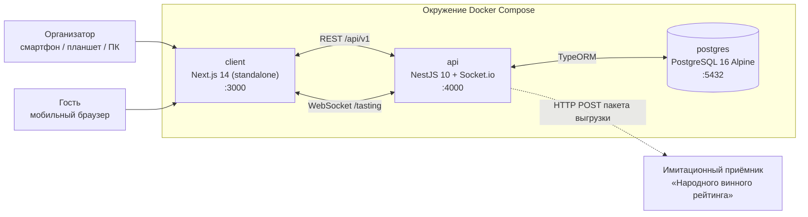

# Конструктор дегустаций

Веб-платформа для организации профессиональных дегустаций вин: от составления программы и проведения синхронных слепых раундов до статистической проверки оценок и выгрузки результатов во внешний рейтинг.

Приложение поставляется единым окружением Docker Compose из трёх контейнеров: клиент на **Next.js 14**, API на **NestJS 10** и база данных **PostgreSQL 16**, объединённые внутренней сетью `tasting_net`.

**Текущий релиз: v1.0.0**

- **Сценарий демонстрации:** [`DEMO.md`](./DEMO.md)
- **Источник требований и архитектуры:** [`architecture.md`](./architecture.md)
- **Документация API (Swagger UI):** <http://localhost:4000/api/docs>
- **Клиент:** <http://localhost:3000>

---

## Содержание

- [О проекте](#о-проекте)
- [Ключевые возможности](#ключевые-возможности)
- [Технологический стек](#технологический-стек)
- [Структура проекта](#структура-проекта)
- [Быстрый старт](#быстрый-старт)
- [Демонстрация](#демонстрация)
- [Порты и эндпоинты](#порты-и-эндпоинты)
- [Переменные окружения](#переменные-окружения)
- [Авторизация и гостевой доступ](#авторизация-и-гостевой-доступ)
- [Работа с базой данных](#работа-с-базой-данных)
- [Локальная разработка](#локальная-разработка)
- [Доступные скрипты](#доступные-скрипты)
- [Проверка работоспособности](#проверка-работоспособности)
- [Статус проекта](#статус-проекта)
- [Соглашения](#соглашения)

---

## О проекте



- **Модульный монолит на NestJS.** Доменная логика разделена на модули `Catalog`, `Auth`, `Events`, `TastingSession`, `Ratings` и `Export` с REST-контроллерами, WebSocket-шлюзом, сервисами и репозиториями TypeORM.
- **Единый мобильный подход.** Организатор получает пульт управления для смартфона и презентационный экран для проектора, гость — лёгкую анкету, открываемую по QR-коду.
- **Изолированная сеть.** Наружу опубликованы только порты клиента (`3000`), API (`4000`) и базы данных (`5432`); внутренний трафик идёт по `tasting_net`.
- **Постоянное хранилище.** Данные PostgreSQL сохраняются в именованном томе `pgdata`: команда `docker compose down` сохраняет их, а `docker compose down -v` полностью сбрасывает.

---

## Ключевые возможности

### 100-балльная шкала Роберта Паркера (`PARKER_100`)

Каждый образец получает 50 базовых баллов, к которым дегустатор добавляет оценки по четырём критериям:

| Критерий | Диапазон | Что оценивается |
| --- | :---: | --- |
| Внешний вид | `0..5` | Прозрачность, глубина цвета, вязкость, визуальные дефекты |
| Аромат и букет | `0..15` | Чистота, интенсивность, сложность и богатство нюансов |
| Вкус и послевкусие | `0..20` | Баланс, структура, тело и длительность послевкусия |
| Общее качество и потенциал | `0..10` | Гармоничность, типичность и потенциал выдержки |

```text
S = 50 + внешний вид + аромат + вкус + потенциал, где S ∈ [50, 100]
```

Итоговый балл автоматически переводится в категорию качества:

| Баллы | Код категории | Наименование |
| --- | --- | --- |
| `95–100` | `CLASSIC` | Великие вина (Classic) |
| `90–94` | `OUTSTANDING` | Выдающиеся вина (Outstanding) |
| `85–89` | `VERY_GOOD` | Очень хорошие вина (Very Good) |
| `80–84` | `GOOD` | Хорошие вина (Good) |
| `70–79` | `AVERAGE` | Посредственные вина (Average) |
| `50–69` | `UNACCEPTABLE` | Неприемлемые / дефектные (Unacceptable) |

### Слепая дегустация и синхронизация в реальном времени

В режиме `BLIND` сервер не передаёт гостям `wineId`, название вина, винодельню, сорт, винтаж или розничную цену до события `bottle_revealed`. Фильтрация выполняется на уровне DTO до отправки ответа и в WebSocket-событиях, поэтому метаданные не попадают в гостевой JSON.

Комнаты Socket.io (`tasting_{eventId}`) синхронизируют все устройства:

- `host:join_event` — явное подключение пульта/экрана к комнате мероприятия;
- `host:start_round` → `round_started`;
- `participant_counter_updated` — счётчики `{ eventId, roundId, connectedCount, votedCount }`;
- `host:lock_voting` → `voting_closed`;
- `host:reveal_bottle` → `bottle_revealed`;
- `host:show_stats` → `bottle_revealed` со свежей статистикой выбранного раскрытого раунда;
- `leaderboard_updated` — зарезервировано для следующего этапа.

Пульт организатора, презентационный экран и анкеты гостей реагируют на одни и те же события, поэтому таймеры, блокировки и раскрытие образцов происходят одновременно. Серверный таймер автоматически переводит раунд в статус `VOTING_CLOSED` и рассылает `voting_closed` с сообщением «Время раунда истекло, голосование закрыто». При перезапуске API активные таймеры восстанавливаются по `started_at` из PostgreSQL, а раунды, срок которых истёк во время простоя, атомарно закрываются при старте.

### Фильтрация выбросов по правилу 2 сигм

Перед агрегацией и выгрузкой сервис `OutlierFilterService` проверяет выборку:

1. При количестве оценок `N < 5` фильтрация не применяется, фактический размер выборки фиксируется в метаданных выгрузки.
2. При `N ≥ 5` вычисляются среднее `μ` и среднеквадратическое отклонение `σ`.
3. Оценки вне интервала `[μ − 2σ, μ + 2σ]` сохраняются с флагом `is_outlier = true`.
4. Выбросы остаются в личной истории гостя, но исключаются из итогового среднего и экспортного пакета.

Это отсекает случайные и намеренно заниженные оценки, сохраняя полный аудит-след. Фильтрация выполняется при запросе статистики и при раскрытии образца; результаты (средний балл, медиана, отклонение, средние по критериям, органолептический профиль и частота дескрипторов) возвращаются REST-эндпоинтом и включаются в событие `bottle_revealed`.

### Каталог российских вин

Модуль `Catalog` работает с таблицей `wines` и содержит стартовый набор из **14 заметных российских вин**:

- регионы: Кубань, Долина Дона, Крым и Севастополь;
- типы: `RED`, `WHITE`, `ROSE`, `SPARKLING`, `FORTIFIED`;
- производители: Винодельня Ведерниковъ, Мысхако, Uppa Winery, Семигорье, Имение Сикоры, Фанагория, Alma Valley, Lefkadia, Абрау-Дюрсо, Массандра и другие.

`GET /api/v1/wines` поддерживает пагинацию (`page`, `limit`) и фильтры `wineType`, `region`, `vintage`, а также нечувствительный к регистру поиск `search` по названию вина и винодельне. Сидер проверяет `external_catalog_id` перед вставкой, поэтому перезапуск API не создаёт дубликаты.

### Выгрузка в «Народный винный рейтинг»

Модуль `Export` реализует паттерн **Адаптер**:

- `PeoplesRatingClientAdapter` формирует типизированный OpenAPI-пакет и отправляет его методом `HTTP POST` на `PEOPLES_RATING_WEBHOOK_URL`.
- Встроенный `PeoplesRatingMockController` по адресу `POST /api/v1/mock/peoples-rating/batch` проверяет пакет через DTO-пайпы, имитирует сетевую задержку около 50 мс и возвращает квитанцию (`receiptId`).
- Перед отправкой для каждого раунда заново применяется фильтрация 2 сигм, поэтому в пакет попадают только валидные оценки.
- Каждая попытка — успешная или неуспешная — сохраняет полный снимок JSON в `export_logs` вместе с адресом назначения, квитанцией и статусом.
- Успешная выгрузка переводит мероприятие в статус `EXPORTED`; историю попыток можно получить через REST и просмотреть в Swagger.

### Авторизация и конструктор мероприятий

- Регистрация и вход организатора по email и паролю с bcrypt-хэшированием и JWT.
- Организатор из `HOST_EMAIL`/`HOST_PASSWORD`/`HOST_NAME` создаётся или обновляется при каждом старте API.
- Мгновенный вход сомелье по QR-коду из пульта управления без повторного ввода пароля.
- Гостевой вход по шестизначному PIN-коду без пароля.
- Аппаратный SHA-256-профиль устройства, блокировка второго браузера/инкогнито и повторное использование гостевой сессии.
- Проверка активных VPN/прокси по HTTP- и WebRTC-адресам, а также по публичному IP хоста.
- Создание дегустации с вложенными раундами и автоматическим PIN-кодом.
- Список, детали, статусы и раунды мероприятия с полными данными вин только для организатора.

### Клиентские интерфейсы

- **Вход организатора** `/host/login` — пустая форма без демо-блоков, сохранение JWT и обработка русскоязычных ошибок.
- **Дашборд** `/host/events` — список дегустаций со статусами, создание программы, выбор режима, шкалы, вин, порядка и длительности раундов.
- **Пульт ведущего** `/host/events/[id]/control` — мобильный экран с PIN, двумя QR-кодами (гостевой и сомелье), таймером, живым счётчиком, управлением раундом, статистикой раскрытого раунда и инспектором экспорта.
- **Экран проектора** `/host/events/[id]/screen` — крупная типографика, только гостевой QR-код, таймер, прогресс голосования и карточка раскрытого вина с Parker-баллом и Recharts-радаром.
- **Дашборд** `/host/events` — карточки мероприятий с быстрой выгрузкой завершённых дегустаций и переходом к просмотру статистики.
- **PWA гостя** `/join/[sessionPin]` — вход по PIN, анкета Паркера или 5 звёзд, органолептика, ароматические дескрипторы, заметки и экран раскрытия.
- **Синхронизация** — Socket.io автоматически переподключается; при потере связи показывается баннер восстановления соединения.

> Все ключевые механики спецификации реализованы: каталог, авторизация, мероприятия, гостевые сессии, WebSocket-синхронизация, оценки Паркера, фильтрация 2 сигм, live-статистика, экспорт с аудит-журналом и полноценный интерфейс организатора и гостя.

---

## Технологический стек

| Уровень | Технологии |
| --- | --- |
| Клиент | Next.js 14 (App Router, standalone), React 18, TypeScript, Tailwind CSS, Lucide, Recharts, Socket.io Client, PWA-манифест |
| API | Node.js 20, NestJS 10, TypeORM, Socket.io, `class-validator`, `class-transformer`, `@nestjs/swagger` |
| База данных | PostgreSQL 16 Alpine |
| Аутентификация | JWT для организатора, bcrypt, аппаратный SHA-256-профиль гостя и VPN-проверка |
| Инфраструктура | Docker, Docker Compose, сеть `tasting_net`, том `pgdata` |

---

## Структура проекта

```text
tasting-wine-builder/
├── api/                              # Серверная часть на NestJS
│   ├── src/
│   │   ├── common/
│   │   │   ├── database/             # Проверка уникальных ограничений
│   │   │   ├── http/                 # Контекст запроса (IP, User-Agent)
│   │   │   └── validation/           # Русскоязычные ошибки валидации
│   │   ├── database/
│   │   │   ├── migrations/
│   │   │   │   ├── 1730000000000-InitialCatalogSchema.ts
│   │   │   │   ├── 1792945874561-EventsAuthSchema.ts
│   │   │   │   ├── 1792950279937-RatingsSchema.ts
│   │   │   │   └── 1792951008275-ExportLogsSchema.ts
│   │   │   ├── data-source.ts        # DataSource для TypeORM CLI
│   │   │   └── database.config.ts
│   │   ├── modules/
│   │   │   ├── auth/
│   │   │   │   ├── dto/
│   │   │   │   ├── entities/         # User, Participant
│   │   │   │   ├── guards/           # JwtAuthGuard
│   │   │   │   ├── interfaces/       # JwtPayload, AuthenticatedRequest
│   │   │   │   ├── services/         # Auth, Fingerprint, HostSeeder
│   │   │   │   ├── auth.constants.ts
│   │   │   │   ├── auth.controller.ts
│   │   │   │   └── auth.module.ts
│   │   │   ├── catalog/
│   │   │   │   ├── data/             # Набор российских вин
│   │   │   │   ├── dto/
│   │   │   │   ├── entities/         # Wine
│   │   │   │   ├── services/         # WineSeederService
│   │   │   │   ├── catalog.controller.ts
│   │   │   │   ├── catalog.module.ts
│   │   │   │   └── catalog.service.ts
│   │   │   ├── events/
│   │   │   │   ├── dto/
│   │   │   │   ├── entities/         # TastingEvent, TastingRound
│   │   │   │   ├── events.controller.ts
│   │   │   │   ├── events.module.ts
│   │   │   │   └── events.service.ts
│   │   │   ├── export/
│   │   │   │   ├── adapters/         # PeoplesRatingClientAdapter
│   │   │   │   ├── dto/              # OpenAPI-контракты выгрузки
│   │   │   │   ├── entities/         # ExportLog
│   │   │   │   ├── mock/             # Имитационный приёмник рейтинга
│   │   │   │   ├── export.controller.ts
│   │   │   │   ├── export.module.ts
│   │   │   │   └── export.service.ts
│   │   │   ├── ratings/
│   │   │   │   ├── dto/
│   │   │   │   ├── entities/         # Rating
│   │   │   │   ├── guards/
│   │   │   │   ├── services/         # ParkerScoreCalculator, OutlierFilter
│   │   │   │   ├── ratings.controller.ts
│   │   │   │   ├── ratings.module.ts
│   │   │   │   └── ratings.service.ts
│   │   │   ├── realtime/             # Publisher и счётчик участников
│   │   │   └── tasting-session/
│   │   │       ├── dto/              # Live-state DTO
│   │   │       ├── guards/           # Доступ к live-state
│   │   │       ├── interfaces/       # Payload и контекст сокета
│   │   │       ├── room-state.service.ts
│   │   │       ├── tasting-session.controller.ts
│   │   │       ├── tasting-session.gateway.ts
│   │   │       ├── tasting-session.module.ts
│   │   │       └── tasting-session.service.ts
│   │   ├── health/
│   │   ├── app.module.ts
│   │   └── main.ts
│   ├── Dockerfile
│   ├── package.json
│   └── tsconfig.json
├── client/                           # Клиент на Next.js 14
│   ├── public/
│   │   ├── favicon.svg
│   │   └── manifest.webmanifest      # PWA-манифест гостя
│   ├── src/
│   │   ├── app/
│   │   │   ├── host/
│   │   │   │   ├── login/page.tsx
│   │   │   │   └── events/
│   │   │   │       ├── page.tsx
│   │   │   │       └── [id]/
│   │   │   │           ├── control/page.tsx
│   │   │   │           └── screen/page.tsx
│   │   │   ├── join/[sessionPin]/page.tsx
│   │   │   ├── globals.css
│   │   │   ├── layout.tsx
│   │   │   └── page.tsx
│   │   ├── components/               # Модалки, QR, Recharts, карточки
│   │   ├── hooks/                    # Host-сессия и Socket.io
│   │   ├── lib/                      # API-клиент, сессии, форматирование
│   │   └── types/                    # API и real-time контракты
│   ├── Dockerfile
│   ├── next.config.mjs
│   ├── tailwind.config.ts
│   └── package.json
├── .env.example                      # Шаблон переменных окружения
├── .gitignore
├── architecture.md                   # Архитектурная спецификация
├── DEMO.md                           # Пошаговый сценарий демонстрации
├── docker-compose.yml
└── README.md
```

`AGENTS.md` является локальным файлом инструкций, исключён из Git и не входит в поставку.

---

## Быстрый старт

### Требования

- Docker Engine 24+ и Docker Compose v2 (Docker Desktop для macOS/Windows);
- свободные порты `3000`, `4000` и `5432`;
- для локальной разработки без Docker: Node.js 20+ и npm 10+.

### Запуск приложения

```bash
git clone <адрес-репозитория>
cd tasting-wine-builder-rshb

cp .env.example .env
# Замените пароли и секреты в .env перед реальным использованием

docker compose up --build
```

Откройте <http://localhost:3000>. API дожидается готовности PostgreSQL, применяет миграции, заполняет каталог и только после этого запускает HTTP-сервер. Клиент стартует после успешной проверки API.

Остановка:

```bash
docker compose down          # сохранить данные базы
docker compose down -v       # удалить том pgdata и все данные
```

### Учётная запись организатора

Учётная запись создаётся или обновляется при каждом старте API из переменных `HOST_EMAIL`, `HOST_PASSWORD` и `HOST_NAME`:

```text
HOST_EMAIL=sommelier@tasting.ru
HOST_PASSWORD=Sommelier2026!
HOST_NAME=Главный Сомелье
```

Если изменить пароль или имя в `.env` и перезапустить контейнер API, существующая учётная запись обновится без очистки базы. Страница входа не содержит предзаполненных полей или демонстрационного блока.

> Перед публикацией обязательно измените пароль по умолчанию.

### Проверка окружения

```bash
docker compose ps
curl http://localhost:4000/api/v1/health
curl -s "http://localhost:4000/api/v1/wines?limit=3" | jq
```

### Демонстрация

Полный сценарий показа — вход сомелье, создание дегустации, экран проектора, мобильный пульт, анкета гостя, раскрытие карточки, 2 сигмы и экспорт — описан в [`DEMO.md`](./DEMO.md). Для показа на смартфонах и планшетах достаточно открыть клиент по локальному IP ноутбука: браузер сам направит REST и Socket.io на тот же хост и порт API, без правок `.env` и пересборки образа.

Ожидаемый ответ healthcheck:

```json
{
  "status": "ok",
  "service": "tasting-constructor-api",
  "version": "0.1.0",
  "uptimeSeconds": 12.34,
  "timestamp": "2026-10-25T14:30:00.000Z"
}
```

---

## Порты и эндпоинты

| Сервис | Адрес | Назначение |
| --- | --- | --- |
| Клиент | <http://localhost:3000> | Next.js: кабинет, проектор и PWA гостя |
| Вход организатора | <http://localhost:3000/host/login> | Авторизация сомелье |
| Пульт ведущего | `/host/events/[id]/control` | Мобильное управление раундами |
| Экран проектора | `/host/events/[id]/screen` | Презентационный режим |
| Анкета гостя | `/join/[sessionPin]` | PWA-форма оценки |
| API | <http://localhost:4000> | NestJS REST и Socket.io |
| Базовый путь API | `http://localhost:4000/api/v1` | Версионированный REST |
| Swagger UI | <http://localhost:4000/api/docs> | Интерактивная документация OpenAPI 3 |
| Healthcheck | <http://localhost:4000/api/v1/health> | Проверка доступности API |
| LAN-адрес для QR | <http://localhost:4000/api/v1/health/network> | Определение локального IPv4-адреса хоста |
| PostgreSQL | `localhost:5432` | База данных (учётные данные из `.env`) |
| WebSocket | `http://localhost:4000/tasting` | Namespace Socket.io для сессий дегустации |

API слушает `0.0.0.0:4000` внутри контейнера и опубликован на хосте через `${API_PORT:-4000}:4000`. Клиент определяет адрес API в браузере по `window.location.hostname`: если страница открыта как `http://192.168.0.105:3000`, запросы уходят на `http://192.168.0.105:4000`. Поэтому `NEXT_PUBLIC_API_URL` больше не требуется менять при смене Wi-Fi сети или IP ноутбука; значение из `.env` используется только как подсказка протокола и порта (по умолчанию `4000`).

### Авторизация

| Метод | Эндпоинт | Доступ | Описание |
| --- | --- | --- | --- |
| `POST` | `/api/v1/auth/register` | Публичный | Регистрация организатора |
| `POST` | `/api/v1/auth/login` | Публичный | Вход и получение Bearer JWT |
| `GET` | `/api/v1/auth/me` | JWT организатора | Профиль для входа по QR-коду без пароля |
| `POST` | `/api/v1/auth/guest-join` | Публичный | Вход гостя по PIN-коду |

### Мероприятия

Все эндпоинты требуют заголовок `Authorization: Bearer <JWT>`.

| Метод | Эндпоинт | Описание |
| --- | --- | --- |
| `POST` | `/api/v1/events` | Создать мероприятие с раундами и PIN-кодом |
| `GET` | `/api/v1/events` | Список мероприятий текущего организатора |
| `GET` | `/api/v1/events/:id` | Детали мероприятия, раунды и количество участников |
| `PATCH` | `/api/v1/events/:id/status` | Изменить статус (`DRAFT`, `ACTIVE`, `FINISHED`) |
| `GET` | `/api/v1/events/:id/rounds` | Раунды с полными данными вин |
| `GET` | `/api/v1/events/:id/live-state` | Состояние сессии для переподключения |

Эндпоинт `live-state` принимает либо `Authorization: Bearer <JWT>` организатора, либо `X-Guest-Token: <guestSessionToken>` гостя. Организатор получает полные данные вина; гость в режиме `BLIND` не получает метаданные вина до раскрытия образца.

### Каталог вин

| Метод | Эндпоинт | Описание |
| --- | --- | --- |
| `GET` | `/api/v1/wines` | Постраничный список с фильтрами `wineType`, `region`, `vintage`, `search` |
| `GET` | `/api/v1/wines/:id` | Данные одного вина |
| `POST` | `/api/v1/wines` | Добавить вино с валидацией DTO |

### Оценки и статистика

| Метод | Эндпоинт | Доступ | Описание |
| --- | --- | --- | --- |
| `POST` | `/api/v1/rounds/:roundId/ratings` | Гость (`X-Guest-Token`) | Отправить оценку активного раунда |
| `GET` | `/api/v1/rounds/:roundId/stats` | Организатор или гость после раскрытия / в `OPEN` | Статистика после фильтрации 2 сигм |

Тело оценки для шкалы `PARKER_100`:

```json
{
  "parkerBreakdown": {
    "appearance": 4,
    "aroma": 14,
    "taste": 17,
    "potential": 9
  },
  "organoleptics": {
    "sweetness": 2,
    "acidity": 7,
    "tannins": 8,
    "body": 8,
    "aromaIntensity": 9
  },
  "aromaTags": ["вишня", "черный перец", "дуб"],
  "personalNotes": "Длительное пряное послевкусие."
}
```

Поле `parkerBreakdown` обязательно для каждой оценки. Повторная оценка того же образца возвращает `409`, закрытый раунд — `423`, а статистика для гостя недоступна до раскрытия в режиме `BLIND`.

### Экспорт и имитационный приёмник

| Метод | Эндпоинт | Доступ | Описание |
| --- | --- | --- | --- |
| `POST` | `/api/v1/events/:eventId/export` | JWT организатора | Выгрузить результаты выбранного мероприятия |
| `GET` | `/api/v1/events/:eventId/export-logs` | JWT организатора | История выгрузок с полными JSON-снимками |
| `POST` | `/api/v1/mock/peoples-rating/batch` | Публичный | Имитационный приёмник «Народного винного рейтинга» |

```bash
curl -s -X POST \
  "http://localhost:4000/api/v1/events/<UUID>/export" \
  -H "Authorization: Bearer <JWT>" | jq
```

Ответ содержит `exportMeta` (идентификатор журнала, квитанцию `pr_mock_…_accepted`, адрес назначения и статус `MOCK_SUCCESS`) и `dispatchedPayload`. Полный снимок `dispatchedPayload` сохраняется в `export_logs`; успешная выгрузка переводит мероприятие в статус `EXPORTED`. При ошибке внешнего сервиса возвращается `502`, но попытка всё равно фиксируется со статусом `FAILED`.

### Пример входа организатора

```bash
curl -s -X POST http://localhost:4000/api/v1/auth/login \
  -H "Content-Type: application/json" \
  -d '{"email":"sommelier@tasting.ru","password":"Sommelier2026!"}' | jq
```

Ответ содержит `accessToken`, тип токена, время жизни и данные пользователя.

### Пример создания мероприятия

```bash
curl -s -X POST http://localhost:4000/api/v1/events \
  -H "Authorization: Bearer <JWT>" \
  -H "Content-Type: application/json" \
  -d '{
    "title": "Слепая дегустация: Автохтоны России",
    "mode": "BLIND",
    "scaleType": "PARKER_100",
    "scheduledAt": "2026-11-14T18:00:00.000Z",
    "rounds": [
      {
        "wineId": "<UUID вина из каталога>",
        "orderNumber": 1,
        "blindLabel": "Образец №1",
        "durationSeconds": 180
      }
    ]
  }' | jq
```

В ответе возвращаются идентификатор мероприятия, шестизначный `sessionPin`, раунды с данными вин и счётчики участников.

### Пример входа гостя

```bash
curl -s -X POST http://localhost:4000/api/v1/auth/guest-join \
  -H "Content-Type: application/json" \
  -H "User-Agent: TastingGuest/1.0" \
  -d '{
    "sessionPin": "482910",
    "nickname": "Алексей (Стол №3)",
    "screenResolution": "390x844",
    "deviceId": "8f14e45f-ceea-467a-8f1e-2c7a8f6f1a11",
    "pixelRatio": 3,
    "colorDepth": 24,
    "timeZone": "Europe/Moscow",
    "osFamily": "iOS",
    "maxTouchPoints": 1,
    "httpPublicIp": null,
    "webrtcPublicIp": null,
    "webrtcLocalIps": [],
    "vpnSuspectedByWebrtc": false
  }' | jq
```

В режиме `BLIND` в `event.currentRound` передаются только `roundId`, `orderNumber`, `blindLabel`, `status`, `durationSeconds` и `remainingSeconds`. Поля `wineId`, название, винодельня, винтаж и цена отсутствуют. В режиме `OPEN` дополнительно возвращается объект `wine` с полными данными.

### WebSocket-синхронизация

Подключение выполняется к namespace `/tasting`:

```js
import { io } from 'socket.io-client';

const socket = io('http://localhost:4000/tasting', {
  auth: {
    token: '<JWT организатора или guestSessionToken>',
  },
});
```

- Организатор подключается с Bearer JWT и автоматически входит в комнаты всех своих мероприятий.
- Гость подключается с `guestSessionToken` и входит только в комнату своего мероприятия.
- При отсутствии или недействительности токена соединение отклоняется с сообщением «Ошибка авторизации: недействительный токен».
- Счётчик участников приходит в событии `participant_counter_updated` с полями `connectedCount` и `votedCount`.

| Событие клиента | Направление | Действие |
| --- | --- | --- |
| `host:join_event` | организатор → сервер | Подписывает пульт/экран на точные счётчики мероприятия |
| `host:start_round` | организатор → сервер | Запускает или перезапускает раунд и таймер |
| `host:lock_voting` | организатор → сервер | Закрывает голосование ведущим |
| `host:reveal_bottle` | организатор → сервер | Раскрывает карточку образца |
| `host:show_stats` | организатор → сервер | Повторно показывает статистику раскрытого раунда всем экранам |

| Событие сервера | Получатели | Полезная нагрузка |
| --- | --- | --- |
| `round_started` | вся комната | Раунд, таймер, `endsAt`; в `BLIND` без метаданных вина |
| `voting_closed` | вся комната | `{ roundId, message }` |
| `bottle_revealed` | вся комната | `{ roundId, orderNumber?, blindLabel?, wine, stats, message }` с полными данными вина и статистикой раунда |
| `participant_counter_updated` | комната | `{ eventId, roundId, connectedCount, votedCount }` |
| `auth_error` / `session_error` | отправитель | Локализованное сообщение об ошибке |

Пример управления раундом:

```js
socket.on('round_started', (payload) => {
  console.log(payload);
});

socket.emit('host:start_round', {
  eventId: '<UUID мероприятия>',
  roundId: '<UUID раунда>',
  durationSeconds: 180,
});
```

В режиме `BLIND` событие `round_started` содержит строго `roundId`, `orderNumber`, `blindLabel`, `scaleType`, `durationSeconds` и `endsAt`. В режиме `OPEN` дополнительно передаётся объект `wine`. При истечении таймера сервер сам закрывает голосование и рассылает `voting_closed`; при действии ведущего сообщение — «Голосование закрыто ведущим».

Перед отправкой `bottle_revealed` сервер применяет правило 2 сигм и добавляет объект `stats` с полями `meanScore`, `qualityCategory`, `criteriaMeans`, `radarProfile` и счётчиками валидных оценок и выбросов. Событие `participant_counter_updated` после каждой оценки содержит актуальный `votedCount`.

---

## Переменные окружения

Перед запуском скопируйте `.env.example` в `.env`. Docker Compose автоматически читает `.env` для подстановки значений.

| Переменная | Значение по умолчанию | Используется | Назначение |
| --- | --- | --- | --- |
| `POSTGRES_USER` | `tasting` | postgres, api | Пользователь базы данных |
| `POSTGRES_PASSWORD` | `change-me-postgres-password` | postgres, api | Пароль базы данных |
| `POSTGRES_DB` | `tasting_constructor` | postgres, api | Имя базы данных |
| `POSTGRES_HOST` | `localhost` | api | Хост базы для локального запуска; в Compose переопределяется на `postgres` |
| `POSTGRES_PORT` | `5432` | postgres, api | Порт базы; внутри Compose API использует `5432` |
| `API_PORT` | `4000` | api | Порт API на хосте |
| `JWT_SECRET` | — | api | Секрет подписи JWT организатора |
| `SERVER_SALT` | — | api | Соль для SHA-256-отпечатка и аппаратного профиля гостя |
| `HOST_EMAIL` | `sommelier@tasting.ru` | api | Email организатора, создаваемого/обновляемого при старте API |
| `HOST_PASSWORD` | `Sommelier2026!` | api | Пароль организатора; изменение применяется после рестарта контейнера |
| `HOST_NAME` | `Главный Сомелье` | api | Отображаемое имя организатора |
| `PEOPLES_RATING_WEBHOOK_URL` | `http://127.0.0.1:4000/api/v1/mock/peoples-rating/batch` | api | Адрес имитационного приёмника выгрузки; loopback работает внутри контейнера при любом LAN IP |
| `HOST_LAN_IP` | — | api | Необязательный LAN IPv4 для QR-кодов, если Docker Desktop скрывает Wi-Fi адаптер хоста |
| `NEXT_PUBLIC_API_URL` | `http://localhost:4000` | client | Необязательная подсказка протокола и порта API; хост всегда берётся из `window.location.hostname` |
| `NEXT_PUBLIC_HOST_IP` | — | client | Необязательная подсказка LAN IP для QR-кодов на этапе сборки |

API читает `POSTGRES_HOST`, `POSTGRES_PORT`, `POSTGRES_USER`, `POSTGRES_PASSWORD` и `POSTGRES_DB`. Внутри Compose хост и порт принудительно равны `postgres:5432`, а локальный запуск использует значения из `.env`.

> `NEXT_PUBLIC_*` по-прежнему встраивается в бандл при `docker compose build`, но теперь это влияет только на порт и протокол. Хост API вычисляется в браузере при каждом запросе, поэтому смена Wi-Fi-сети или LAN IP не требует пересборки. Пересборка нужна только если вы меняете порт API и хотите обновить подсказку одновременно с `API_PORT`.
>
> Если `.env` был создан до этого обновления, замените `PEOPLES_RATING_WEBHOOK_URL` на `http://127.0.0.1:4000/api/v1/mock/peoples-rating/batch`: значения из `.env` имеют приоритет над дефолтами Compose.

Файл `.env` запрещено коммитить: он исключён через `.gitignore`.

---

## Авторизация и гостевой доступ

### Организатор

- Учётная запись создаётся или обновляется при старте API из `HOST_EMAIL`, `HOST_PASSWORD` и `HOST_NAME`; смена пароля в `.env` применяется после перезапуска контейнера.
- Страница `/host/login` не содержит предзаполненных полей или демонстрационного блока.
- Пароль хранится только в виде bcrypt-хэша (12 раундов соли).
- Успешный вход возвращает Bearer JWT со сроком жизни 12 часов.
- Защищённые эндпоинты проверяют подпись токена и роль `HOST` или `ADMIN`.
- При неверных учётных данных возвращается `401` с сообщением «Неверный email или пароль».
- Для доступа к чужим мероприятиям возвращается `404`, чтобы не раскрывать их существование.

### Гость

Гостевой вход не требует пароля и работает по PIN-коду сессии. Браузер сохраняет постоянный `deviceId` в `localStorage` (`tasting.device.id`) и долгоживущей cookie (`tasting_device_id`). Дополнительно собирается аппаратный профиль, не зависящий от браузера, и разрешение экрана нормализуется как `minxMax`, поэтому поворот телефона не создаёт нового гостя.

```text
fingerprintHash = SHA-256(clientIp + deviceId + userAgent + normalizedScreenResolution + eventId + SERVER_SALT)

environmentHash = SHA-256(
  osFamily + normalizedScreenResolution + pixelRatio + colorDepth +
  timeZone + maxTouchPoints + eventId + SERVER_SALT
)
```

- `environmentHash` не содержит `User-Agent` и название браузера: Chrome, Safari, Firefox, Edge и инкогнито на одном устройстве дают одинаковый аппаратный профиль.
- Вторая регистрация с тем же аппаратным профилем, но другим `deviceId` блокируется с `409 Conflict`: «С этого устройства уже выполнен вход в дегустацию (в другом браузере или режиме инкогнито). Повторная регистрация с одного устройства запрещена.»
- При повторном входе с тем же `deviceId` и тем же IP возвращается существующий `participantId` и `guestSessionToken`, имя и статус онлайна обновляются.
- Смена IP или включение VPN для уже зарегистрированного устройства блокируется с `403 Forbidden`: «Обнаружено использование VPN или прокси. Отключите VPN и подключитесь напрямую к сети Wi-Fi организатора.»
- Клиент параллельно проверяет публичный IP через HTTP и WebRTC, а также локальные WebRTC-адреса. Сервер сравнивает их с публичным IP хоста (кэш 60 секунд). Несовпадение, VPN-диапазон `100.64.0.0/10` или заголовки `Via`/`Forwarded` дают `403`.
- Если браузер находится за Docker Desktop NAT (`172.16.0.0/12` или `127.0.0.1`), сервер использует LAN-адрес из WebRTC-кандидатов как эффективный `clientIp`, поэтому ограничения по IP продолжают работать.
- IP нормализуется: IPv4-mapped IPv6 (`::ffff:192.168.1.42`) приводится к IPv4, `::1` — к `127.0.0.1`; при наличии прокси предпочитаются `X-Real-IP` и первый валидный адрес `X-Forwarded-For`.
- Уникальный индекс `(event_id, fingerprint_hash)` защищает от дублирования гостя; индексы `(event_id, client_ip)` и `(event_id, device_id)` ускоряют проверки.
- `guestSessionToken` также защищён уникальным индексом.
- Черновик формы хранится отдельно для каждого раунда (`tasting.form.<roundId>`): ползунки, звёзды, теги и заметки восстанавливаются после перезапуска раунда или перезагрузки страницы.
- Повторная отправка оценки в активном раунде обновляет существующую запись, сбрасывает флаг выброса и возвращает полный органолептический профиль.
- В слепом режиме ответ строго не содержит `wineId` и метаданных вина.
- Сообщения об ошибках валидации (`PIN-код должен состоять из 6 цифр`, `Идентификатор устройства обязателен` и другие) возвращаются на русском языке.

### QR-коды и вход сомелье без пароля

- API определяет LAN-адрес по приоритету: `HOST_LAN_IP`/`NEXT_PUBLIC_HOST_IP` → hostname из `NEXT_PUBLIC_API_URL` → ручной runtime override → последний LAN-запрос → физические сетевые интерфейсы.
- Клиент предпочитает реальный не-loopback hostname браузера, затем валидный `NEXT_PUBLIC_HOST_IP`, ответ `GET /api/v1/health/network`, WebRTC host-кандидаты и сохранённый `localStorage` (`tasting.host.lanIp`).
- Если организатор открыл пульт через `http://localhost:3000`, QR-коды всё равно строятся как `http://<LAN_IP>:3000/...`. Полный адрес отображается под каждым QR для визуальной проверки.
- Если Docker Desktop не позволяет определить LAN-адрес автоматически, в модальном окне QR можно ввести его вручную. Значение сохраняется в `localStorage` и синхронизируется с API через `PUT /api/v1/health/network`.
- В пульте ведущего доступны две вкладки: «Для гостей» (`/join/<PIN>`) и «Для сомелье (пульт)». Вторая содержит ссылку `/host/events/<ID>/control?hostToken=<JWT>` и предупреждение «Только для ведущего и сомелье — мгновенный вход в пульт управления без пароля».
- При открытии ссылки клиент сохраняет JWT в `localStorage`, удаляет `hostToken` из адресной строки через `history.replaceState`, получает профиль через `GET /api/v1/auth/me` (с fallback-декодированием JWT) и сразу открывает пульт без перехода на `/host/login`.
- Экран проектора `/host/events/<ID>/screen` содержит только гостевой QR-код и никогда не показывает QR сомелье или `hostToken`.

---

## Работа с базой данных

API работает с `synchronize: false`: схема изменяется только миграциями TypeORM. При старте (`migrationsRun: true`) применяются все ожидающие миграции, после чего запускаются сидеры.

Текущие сущности:

- `wines` — каталог вин;
- `users` — организаторы и администраторы;
- `tasting_events` — мероприятия с уникальным PIN-кодом;
- `tasting_rounds` — раунды мероприятия с внешним ключом на вино;
- `participants` — гостевые сессии с уникальным отпечатком, IP-адресом, постоянным `device_id` и хэшем профиля окружения;
- `ratings` — оценки раунда с критериями Паркера, органолептикой и флагом выброса;
- `export_logs` — аудит-журнал выгрузок с полным JSON-снимком и квитанцией.

Ключевые ограничения:

- `uq_users_email` — уникальный email организатора;
- `uq_tasting_events_session_pin` — уникальный шестизначный PIN-код;
- `uq_tasting_rounds_event_order` — уникальный порядковый номер раунда в мероприятии;
- `uq_participants_event_fingerprint` — один участник на отпечаток в рамках мероприятия;
- `idx_participants_event_client_ip` и `idx_participants_event_device_id` — быстрые проверки IP и устройства гостя в рамках мероприятия;
- `uq_ratings_round_participant` — одна оценка участника на раунд;
- `chk_parker_subscores_bounds` — границы критериев Паркера;
- `chk_organoleptics_bounds` и `chk_total_score_bounds` — диапазоны органолептики и итогового балла;
- `idx_ratings_round_valid` — частичный индекс только по валидным оценкам;
- `idx_export_logs_event_id` — быстрый поиск истории выгрузок;
- `fk_tasting_rounds_event`, `fk_participants_event`, `fk_ratings_round`, `fk_ratings_participant`, `fk_export_logs_event` — каскадное удаление связанных записей.

Ручные команды выполняются из каталога `api/`:

```bash
npm run migration:show      # применённые и ожидающие миграции
npm run migration:run       # применить ожидающие миграции
npm run migration:revert    # откатить последнюю миграцию
```

Проверка отсутствия расхождений между сущностями и схемой:

```bash
npm run typeorm -- schema:log
```

Инспекция живой базы:

```bash
docker compose exec postgres psql -U tasting -d tasting_constructor
```

---

## Локальная разработка

Рекомендуемый способ запуска — Docker Compose. Для итеративной разработки приложения можно запускать на хосте, оставив PostgreSQL в Docker.

### 1. Запустить только PostgreSQL

```bash
docker compose up -d postgres
```

### 2. Запустить API

```bash
cd api
npm install
npm run start:dev
```

API будет доступен по адресу <http://localhost:4000>, Swagger — по адресу <http://localhost:4000/api/docs>. `ConfigModule` читает `api/.env` и `.env` в корне репозитория.

### 3. Запустить клиент

```bash
cd client
npm install
npm run dev
```

Клиент будет доступен по адресу <http://localhost:3000>. При открытии с другого устройства он автоматически использует `http://<текущий-LAN-IP>:4000`; `NEXT_PUBLIC_API_URL` служит только подсказкой порта и протокола.

### Пересборка после изменения зависимостей

```bash
docker compose build --no-cache api client
docker compose up
```

---

## Доступные скрипты

### API (`api/`)

| Скрипт | Описание |
| --- | --- |
| `npm run build` | Сборка NestJS в каталог `dist/` |
| `npm run migration:run` | Применить ожидающие миграции |
| `npm run migration:revert` | Откатить последнюю миграцию |
| `npm run migration:show` | Показать применённые и ожидающие миграции |
| `npm run start` | Запуск без режима наблюдения |
| `npm run start:dev` | Запуск с горячей перезагрузкой |
| `npm run start:debug` | Запуск с отладчиком Node.js |
| `npm run start:prod` | Запуск собранного приложения |
| `npm run typecheck` | Проверка типов без генерации файлов |

### Клиент (`client/`)

| Скрипт | Описание |
| --- | --- |
| `npm run dev` | Запуск Next.js в режиме разработки |
| `npm run build` | Production-сборка (`output: 'standalone'`) |
| `npm run start` | Запуск production-сборки |
| `npm run typecheck` | Проверка типов без генерации файлов |

---

## Проверка работоспособности

```bash
# Проверка типов и сборки
cd api && npm run typecheck && npm run build
cd ../client && npm run typecheck && npm run build

# Проверка конфигурации Compose
docker compose config --quiet

# Запуск и состояние контейнеров
docker compose up --build
docker compose ps

# Проверка API и каталога
curl http://localhost:4000/api/v1/health
curl -s "http://localhost:4000/api/v1/wines?limit=3" | jq

# Проверка входа организатора из HOST_EMAIL/HOST_PASSWORD
curl -s -X POST http://localhost:4000/api/v1/auth/login \
  -H "Content-Type: application/json" \
  -d '{"email":"sommelier@tasting.ru","password":"Sommelier2026!"}' | jq

# Состояние сессии для организатора и гостя
curl -s "http://localhost:4000/api/v1/events/<UUID>/live-state" \
  -H "Authorization: Bearer <JWT>" | jq
curl -s "http://localhost:4000/api/v1/events/<UUID>/live-state" \
  -H "X-Guest-Token: <guestSessionToken>" | jq
```

WebSocket-сценарий проверяется клиентом Socket.io: подключение к `http://localhost:4000/tasting` с `auth.token`, затем последовательность `host:start_round` → `round_started`, `host:lock_voting` → `voting_closed`, `host:reveal_bottle` → `bottle_revealed`.

```bash
# LAN-адрес для QR и профиль текущего организатора
curl -s http://localhost:4000/api/v1/health/network | jq
curl -s http://localhost:4000/api/v1/auth/me \
  -H "Authorization: Bearer <JWT>" | jq
```

Полный пользовательский сценарий проверяется в браузере: вход организатора, создание дегустации, открытие пульта и экрана проектора, вход гостя по PIN, отправка оценки, обновление счётчика, раскрытие карточки с радаром и выгрузка в имитационный рейтинг. Дополнительно проверяются: отказ второму браузеру/инкогнито на том же устройстве (`409`), отказ при VPN/смене IP (`403`), LAN-адреса в обоих QR и вход сомелье по QR без пароля.

---

## Статус проекта

**Этап 0 — завершён**

- [x] Структура монорепозитория, правила `.gitignore` и шаблон окружения
- [x] Docker Compose с цепочкой зависимостей и healthcheck PostgreSQL
- [x] Каркас NestJS с версионированием, валидацией, CORS, Swagger и healthcheck
- [x] Каркас Next.js 14 App Router с Tailwind CSS и standalone-сборкой

**Этап 1 — завершён**

- [x] TypeORM на переменных `POSTGRES_*`, `synchronize: false`
- [x] Сущность `Wine`, миграция и индексы каталога
- [x] REST API каталога с пагинацией, фильтрами и валидацией
- [x] Идемпотентный сидер 14 российских вин

**Этап 2 — завершён**

- [x] Сущности `User`, `TastingEvent`, `TastingRound`, `Participant`
- [x] Миграция `EventsAuthSchema` с перечислениями, внешними ключами и индексами
- [x] Регистрация и вход организатора с bcrypt и JWT
- [x] Демонстрационный аккаунт «Главный Сомелье»
- [x] Гостевой вход по PIN-коду и SHA-256-отпечатку устройства
- [x] Приватность слепого режима на уровне DTO
- [x] Создание, список, детали, статусы и раунды мероприятий
- [x] Русскоязычные сообщения API, интерфейс клиента и README

**Этап 3 — завершён**

- [x] Socket.io namespace `/tasting` с CORS и авторизацией рукопожатия
- [x] Комнаты `tasting_{eventId}` и изоляция мероприятий
- [x] Обновление `is_online` при подключении и отключении гостя
- [x] Счётчик участников `participant_counter_updated`
- [x] Серверные таймеры и автоматическое закрытие голосования
- [x] Действия организатора: старт раунда, блокировка и раскрытие образца
- [x] Приватность `BLIND` в событии `round_started` и полные данные в `OPEN`
- [x] REST-эндпоинт `GET /api/v1/events/:id/live-state` для переподключения

**Этап 4 — завершён**

- [x] Сущность `Rating` и миграция `RatingsSchema` с ограничениями и частичным индексом
- [x] Калькулятор `ParkerScoreCalculator` и русские категории качества
- [x] `OutlierFilterService` с фильтрацией 2 сигм и сохранением флагов выбросов
- [x] `POST /api/v1/rounds/:roundId/ratings` с проверками 409/423
- [x] `GET /api/v1/rounds/:roundId/stats` с доступом по роли и режиму
- [x] Обновление `votedCount` в реальном времени
- [x] Обогащение `bottle_revealed` статистикой раунда

**Этап 5 — завершён**

- [x] Сущность `ExportLog` и миграция `ExportLogsSchema`
- [x] OpenAPI-контракты `ExportPayloadDto` и `ExportSampleDto` с валидацией
- [x] Имитационный приёмник «Народного винного рейтинга» с квитанцией
- [x] Адаптер `PeoplesRatingClientAdapter` с обработкой ошибок и таймаутом
- [x] `POST /api/v1/events/:eventId/export` с обновлением статуса `EXPORTED`
- [x] `GET /api/v1/events/:eventId/export-logs` с полными снимками
- [x] Аудит успешных и неуспешных попыток в `export_logs`

**Релиз v1.0.0 — готов**

- [x] Все этапы 0–6 завершены и проверены end-to-end в браузере
- [x] Docker-окружение из трёх сервисов, миграции и сидеры
- [x] Полный сценарий демонстрации в [`DEMO.md`](./DEMO.md)
- [x] Git-тег `v1.0.0`

**Этап 6 — завершён**

- [x] Типизированный API-клиент и Socket.io-хук с переподключением
- [x] Вход организатора и дашборд мероприятий
- [x] Конструктор дегустации с выбором вин, режима и шкалы
- [x] Мобильный пульт ведущего с QR-кодом и живыми счётчиками
- [x] Управление стартом, блокировкой и раскрытием раунда
- [x] Инспектор экспорта с квитанцией и скачиванием JSON
- [x] Презентационный экран с таймером, анимацией раскрытия и Recharts-радаром
- [x] PWA гостя с калькулятором Паркера, органолептикой, тегами и заметками
- [x] Русская локализация всех интерфейсов и баннеры переподключения

**Пострелизные исправления — завершены**

- [x] Аппаратный `environmentHash` без `User-Agent`, блокировка второго браузера и инкогнито
- [x] Проверка VPN/прокси по HTTP, WebRTC и публичному IP хоста
- [x] LAN-адрес вместо `localhost` во всех QR-кодах и ручной ввод адреса при необходимости
- [x] Беспарольный вход сомелье по QR из пульта и очистка `hostToken` из адресной строки
- [x] Экран проектора не содержит QR сомелье и токен организатора

**Дальнейшее развитие**

- [ ] Production-hardening: мониторинг, ограничение частоты запросов, e2e-CI
- [ ] Расширение каталога вин и импорт из внешнего реестра

---

## Соглашения

- **Коммиты:** Conventional Commits на английском, например `feat(events): add round timer gateway`.
- **Исходный код:** имена переменных, классов, колонок и типов — на английском; `strict: true`, без `any`.
- **Пользовательские тексты:** интерфейс, сообщения API, описания Swagger и README — на русском.
- **Версионирование API:** все REST-маршруты находятся под `/api/v1`, Swagger доступен по `/api/docs`.
- **Безопасность:** `AGENTS.md`, `.env` и локальные секреты исключены из Git. Метаданные вина нельзя раскрывать гостям до события `bottle_revealed`.
