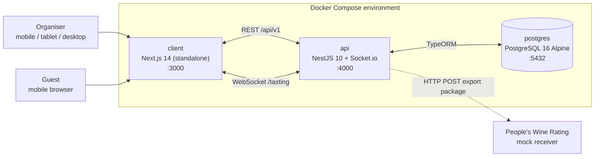

# Tasting Constructor

A full-stack platform for organising professional wine tastings — from building a tasting programme and running live blind sessions to aggregating scores with statistical validation and exporting the results to an external rating service.

The application ships as a single Docker Compose environment with three containers: a **Next.js 14** client, a **NestJS 10** API and a **PostgreSQL 16** database, connected through the internal bridge network `tasting_net`.

- **Source of truth for product and domain requirements:** [`architecture.md`](./architecture.md)
- **API documentation (Swagger UI):** <http://localhost:4000/api/docs>
- **Client:** <http://localhost:3000>

---

## Table of Contents

- [Core Architecture](#core-architecture)
- [Key Features](#key-features)
- [Technology Stack](#technology-stack)
- [Project Structure](#project-structure)
- [Quick Start](#quick-start)
- [Ports and Endpoints](#ports-and-endpoints)
- [Environment Variables](#environment-variables)
- [Local Development](#local-development)
- [Available Scripts](#available-scripts)
- [Project Status](#project-status)
- [Conventions](#conventions)

---

## Core Architecture



- **Modular monolith API.** Domain logic is split into `Catalog`, `Events`, `Auth`, `TastingSession`, `Ratings` and `Export` modules with REST controllers, a Socket.io gateway, services and TypeORM repositories.
- **Mobile-first client.** The organiser gets a one-handed mobile control panel and a TV/presentation screen; guests get a lightweight tasting form opened from a QR code.
- **Single Docker network.** Only the client (`3000`), API (`4000`) and database (`5432`) ports are published; all internal traffic stays on `tasting_net`.
- **Persistent database.** PostgreSQL data is stored in the named volume `pgdata`, so `docker compose down` keeps the data and `docker compose down -v` resets it.

---

## Key Features

### Robert Parker 100-point scale (`PARKER_100`)

Every sample starts with 50 base points, to which the taster adds four criteria:

| Criterion | Range | Description |
| --- | :---: | --- |
| Appearance | `0..5` | Clarity, colour depth, viscosity, visual defects |
| Aroma / bouquet | `0..15` | Purity, intensity, complexity and aromatic nuance |
| Taste & finish | `0..20` | Balance, structure, body and length of finish |
| Overall quality & potential | `0..10` | Harmony, typicity and ageing potential |

```text
total = 50 + appearance + aroma + taste + potential   ∈ [50, 100]
```

The resulting score is mapped automatically to a quality category:

| Score | Category |
| --- | --- |
| `95–100` | `CLASSIC` — great wines |
| `90–94` | `OUTSTANDING` — outstanding wines |
| `85–89` | `VERY_GOOD` — very good wines |
| `80–84` | `GOOD` — good wines |
| `70–79` | `AVERAGE` — average wines |
| `50–69` | `UNACCEPTABLE` — faulty / unacceptable wines |

A simplified 5-star scale (`STARS_5`) is projected onto the Parker range with `x = 50 + 12.5 × (s − 1)`.

### Blind tasting with real-time state synchronisation

In `BLIND` mode the API never exposes the wine identity — `wineId`, name, winery, grape varieties, vintage or retail price — to guest clients until the host triggers `host:reveal_bottle` and the server broadcasts `bottle_revealed`.

Socket.io rooms (`tasting_{eventId}`) keep every device in sync:

- `host:start_round` → `round_started`
- `participant_counter_updated` (connected / voted counters)
- `host:lock_voting` → `voting_closed`
- `host:reveal_bottle` → `bottle_revealed`
- `leaderboard_updated`

The organiser control panel, presentation screen and guest forms react to the same events, so timers, locks and reveals happen simultaneously for everyone.

### 2-sigma outlier filtering

Before results are aggregated or exported, the `OutlierFilterService` validates the sample:

1. For fewer than 5 ratings (`N < 5`) no filtering is applied; the real sample size is recorded in export metadata.
2. For `N ≥ 5`, compute the mean `μ` and population standard deviation `σ`.
3. Ratings outside `[μ − 2σ, μ + 2σ]` are persisted with `is_outlier = true`.
4. Outliers remain visible in the guest's personal history but are excluded from the final mean and from the export snapshot.

This suppresses accidental or malicious extreme scores without discarding the audit trail.

### People's Wine Rating export adapter & mock receiver

The `ExportModule` demonstrates an external integration with the **Adapter** pattern:

- `PeoplesRatingClientAdapter` builds a typed OpenAPI payload and sends it with HTTP `POST` to `PEOPLES_RATING_WEBHOOK_URL`.
- The built-in `PeoplesRatingMockController` at `POST /api/v1/mock/peoples-rating/batch` validates the payload with DTO pipes, simulates external latency and returns a signed-looking receipt (`receiptId`).
- Every attempt stores the complete payload snapshot in the `export_logs` table for auditing.
- The organiser can inspect and download the generated JSON package from the client.

### Integrity safeguards

- `UNIQUE(round_id, participant_id)` on ratings — the database rejects duplicate votes (`23505`).
- `UNIQUE(event_id, fingerprint_hash)` on participants — one guest session per device and event.
- SHA-256 guest fingerprint built from client IP, user agent, screen resolution, event ID and `SERVER_SALT`.
- `CHECK` constraints enforce Parker sub-score bounds at the database level.

> Features marked in this section describe the target product defined in `architecture.md`. Phase 0 delivers the runnable infrastructure and application shells; domain modules are implemented in subsequent phases. See [Project Status](#project-status).

---

## Technology Stack

| Layer | Technology |
| --- | --- |
| Client | Next.js 14 (App Router, standalone output), React 18, TypeScript, Tailwind CSS, Lucide (planned), Recharts (planned) |
| API | Node.js 20, NestJS 10, TypeORM, Socket.io, `class-validator`, `@nestjs/swagger` |
| Database | PostgreSQL 16 Alpine |
| Infrastructure | Docker, Docker Compose, bridge network `tasting_net`, named volume `pgdata` |
| Auth | Organiser JWT, passwordless guest sessions with SHA-256 device fingerprints |

---

## Project Structure

```text
tasting-wine-builder/
├── api/                          # NestJS backend
│   ├── src/
│   │   ├── health/               # Liveness probe (GET /api/v1/health)
│   │   │   ├── dto/
│   │   │   │   └── health-response.dto.ts
│   │   │   ├── health.controller.ts
│   │   │   └── health.module.ts
│   │   ├── app.module.ts
│   │   └── main.ts               # Bootstrap, global prefix, validation, Swagger
│   ├── .dockerignore
│   ├── Dockerfile                # Multi-stage production image
│   ├── nest-cli.json
│   ├── package.json
│   ├── tsconfig.build.json
│   └── tsconfig.json
├── client/                       # Next.js 14 frontend
│   ├── public/
│   ├── src/
│   │   ├── app/
│   │   │   ├── globals.css
│   │   │   ├── layout.tsx
│   │   │   └── page.tsx
│   │   └── ...
│   ├── .dockerignore
│   ├── Dockerfile                # Multi-stage standalone production image
│   ├── next-env.d.ts
│   ├── next.config.mjs
│   ├── package.json
│   ├── postcss.config.mjs
│   ├── tailwind.config.ts
│   └── tsconfig.json
├── .env.example                  # Environment template
├── .gitignore
├── architecture.md               # Detailed architecture specification
├── docker-compose.yml
└── README.md
```

The API will grow by feature modules (`catalog`, `events`, `auth`, `tasting-session`, `ratings`, `export`) under `api/src/`, and the client by route groups (`host`, `join`, presentation screen) under `client/src/app/`. `AGENTS.md` is intentionally local-only and ignored by Git.

---

## Quick Start

### Prerequisites

- Docker Engine 24+ with Docker Compose v2 (Docker Desktop on macOS/Windows)
- Ports `3000`, `4000` and `5432` available on the host
- Optional for local, non-Docker development: Node.js 20+, npm 10+

### Run the full stack

```bash
git clone <repository-url>
cd tasting-wine-builder-rshb

cp .env.example .env
# Edit .env and set real secrets for JWT_SECRET and SERVER_SALT

docker compose up --build
```

Open <http://localhost:3000>. The API waits for a healthy PostgreSQL instance, and the client starts only after the API health check passes.

Stop the stack:

```bash
docker compose down          # keep database data
docker compose down -v       # also remove the pgdata volume
```

### Verify the environment

```bash
docker compose ps
curl http://localhost:4000/api/v1/health
```

A healthy response looks like:

```json
{
  "status": "ok",
  "service": "tasting-constructor-api",
  "version": "0.1.0",
  "uptimeSeconds": 12.34,
  "timestamp": "2026-10-25T14:30:00.000Z"
}
```

---

## Ports and Endpoints

| Service | URL / port | Description |
| --- | --- | --- |
| Client | <http://localhost:3000> | Next.js application |
| API | <http://localhost:4000> | NestJS REST + Socket.io |
| API base path | `http://localhost:4000/api/v1` | Versioned REST prefix |
| Swagger UI | <http://localhost:4000/api/docs> | Interactive OpenAPI 3 documentation |
| Health check | <http://localhost:4000/api/v1/health> | Container liveness probe |
| PostgreSQL | `localhost:5432` | Database (credentials from `.env`) |
| WebSocket namespace | `/tasting` | Real-time tasting room (planned) |

The API binds to `0.0.0.0` inside its container. `NEXT_PUBLIC_API_URL` must therefore be a browser-reachable address such as `http://localhost:4000`.

---

## Environment Variables

Copy `.env.example` to `.env` before starting the stack. Docker Compose reads `.env` automatically for variable substitution.

| Variable | Default | Used by | Purpose |
| --- | --- | --- | --- |
| `POSTGRES_USER` | `tasting` | postgres, api | Database user |
| `POSTGRES_PASSWORD` | `change-me-postgres-password` | postgres, api | Database password |
| `POSTGRES_DB` | `tasting_constructor` | postgres, api | Database name |
| `POSTGRES_PORT` | `5432` | postgres | Host port mapped to PostgreSQL |
| `API_PORT` | `4000` | api | Host port mapped to the API |
| `JWT_SECRET` | — | api | Signing key for organiser JWTs |
| `SERVER_SALT` | — | api | Salt for SHA-256 guest fingerprints |
| `PEOPLES_RATING_WEBHOOK_URL` | `http://localhost:4000/api/v1/mock/peoples-rating/batch` | api | Export adapter target; defaults to the built-in mock receiver |
| `NEXT_PUBLIC_API_URL` | `http://localhost:4000` | client | Browser-facing API base URL (inlined at build time) |

Inside the Compose network the API also receives `DB_HOST=postgres`, `DB_PORT=5432`, `DB_USERNAME`, `DB_PASSWORD` and `DB_NAME`. These are derived from the `POSTGRES_*` values, so credentials are defined only once.

> `NEXT_PUBLIC_*` variables are embedded into the client bundle during `docker compose build`. Rebuild the client image after changing `NEXT_PUBLIC_API_URL`.

Never commit `.env`; it is covered by `.gitignore`.

---

## Local Development

The Docker Compose setup is the recommended way to run the project. For iterative development you can run the applications directly on the host while PostgreSQL stays in Docker.

### 1. Start PostgreSQL only

```bash
docker compose up -d postgres
```

### 2. Run the API

```bash
cd api
npm install
npm run start:dev
```

The API is available at <http://localhost:4000> with Swagger at <http://localhost:4000/api/docs>. When running outside Docker, export the variables from `.env` in your shell or create `api/.env`; `ConfigModule` reads both `api/.env` and the repository root `.env`.

### 3. Run the client

```bash
cd client
npm install
npm run dev
```

The client is available at <http://localhost:3000> and talks to `NEXT_PUBLIC_API_URL` (default `http://localhost:4000`).

### Rebuild after dependency changes

```bash
docker compose build --no-cache api client
docker compose up
```

---

## Available Scripts

### API (`api/`)

| Script | Description |
| --- | --- |
| `npm run build` | Compile NestJS to `dist/` |
| `npm run start` | Start the API without watch mode |
| `npm run start:dev` | Start with hot reload |
| `npm run start:debug` | Start with the Node inspector |
| `npm run start:prod` | Run the compiled build |
| `npm run typecheck` | TypeScript check without emitting files |

### Client (`client/`)

| Script | Description |
| --- | --- |
| `npm run dev` | Start Next.js in development mode |
| `npm run build` | Create a production build (`output: 'standalone'`) |
| `npm run start` | Serve the production build locally |
| `npm run typecheck` | TypeScript check without emitting files |

---

## Project Status

**Phase 0 — complete**

- [x] Monorepo layout, root ignore rules and environment template
- [x] Docker Compose stack with healthy PostgreSQL dependency chain
- [x] NestJS API shell with versioned prefix, validation pipe, CORS, Swagger and health endpoint
- [x] Next.js 14 App Router shell with Tailwind CSS and standalone production image
- [x] English project documentation

**Upcoming phases**

- [ ] Database schema, TypeORM entities, migrations and wine catalog seed
- [ ] Organiser auth, guest join flow and fingerprint anti-fraud
- [ ] Event and round builder with `OPEN` / `BLIND` modes and `PARKER_100` / `STARS_5` scales
- [ ] Socket.io tasting room, timers, vote locking and synchronous reveal
- [ ] Ratings, Parker score calculation and 2-sigma outlier filtering
- [ ] Export adapter, mock receiver, `export_logs` audit trail and JSON inspector
- [ ] Mobile control panel, presentation screen and guest PWA

---

## Conventions

- **Commits:** Conventional Commits, e.g. `feat(api): add round timer gateway`, `fix(client): correct touch target height`, `chore: update dependencies`.
- **TypeScript:** `strict` mode everywhere; avoid `any`.
- **API versioning:** all REST routes live under `/api/v1`; Swagger stays at `/api/docs`.
- **Security:** `AGENTS.md` and all `.env` files are ignored by Git. Never hard-code credentials or reveal wine metadata to guests before `bottle_revealed`.
