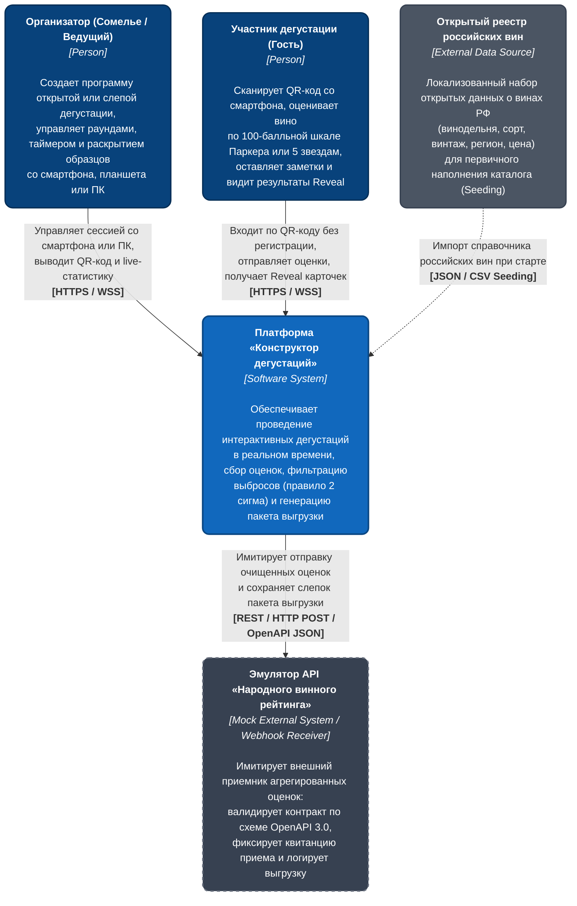
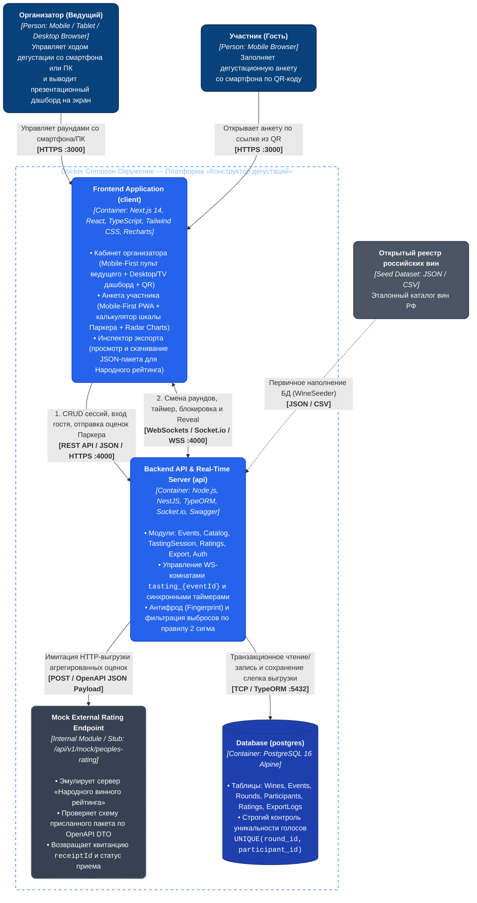
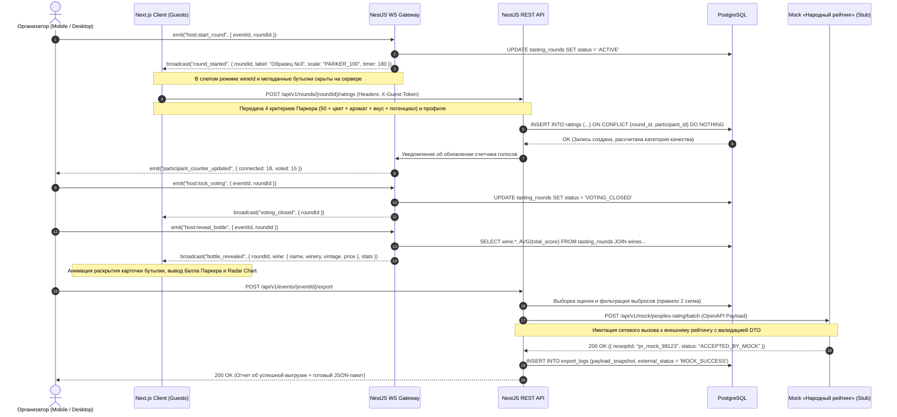
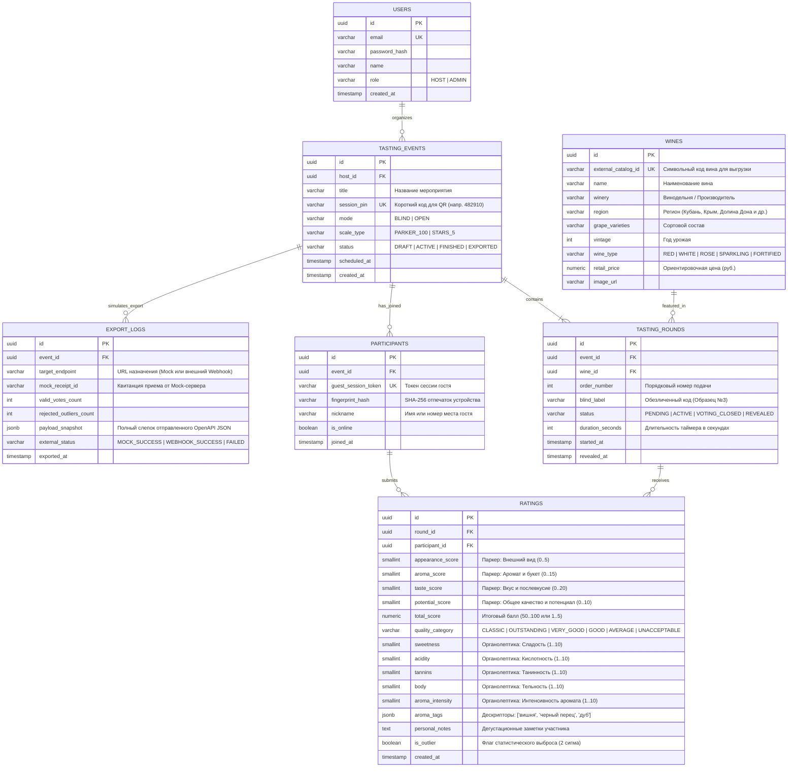
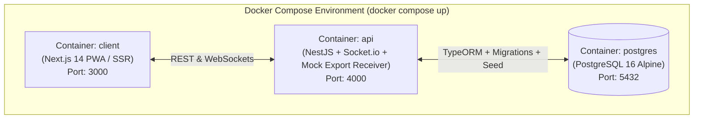

# Архитектурная документация: «Конструктор дегустаций»

## 1. Архитектурный обзор

Система **«Конструктор дегустаций»** спроектирована как модульное клиент-серверное веб-приложение с поддержкой синхронизации состояния в реальном времени (Real-Time State Synchronization). В основе системы лежит стек **Next.js + NestJS + PostgreSQL**, упакованный в изолированное Docker-окружение.

### Ключевые архитектурные принципы
1. **Строгая модульная архитектура (Modular Monolith на базе NestJS):** Бизнес-логика разделена на слабосвязанные доменные модули (`Events`, `Catalog`, `TastingSession`, `Ratings`, `Export`, `Auth`) с четким разграничением слоев контроллеров (REST), шлюзов (WebSockets), сервисов и репозиториев (TypeORM).
2. **Единый Mobile-First подход для всех ролей (Next.js PWA / SSR / CSR):**
   * **Кабинет организатора (Mobile / Tablet / Desktop + Presentation View):** Полностью адаптирован для управления дегустацией со смартфона или планшета в одной руке (во время работы сомелье в зале при подаче образцов), а также с персонального компьютера. Дополнительно включает презентационный режим (Presentation Mode) для вывода динамического QR-кода и живой аналитики на внешний экран или проектор.
   * **Клиент участника (Mobile-First PWA):** Легковесный адаптивный интерфейс для смартфонов гостей с минимальным временем загрузки (First Contentful Paint $< 0.8\text{ s}$), быстрым вводом оценок по 100-балльной шкале Роберта Паркера или 5-звездочной шкале и мгновенным откликом на команды ведущего.
3. **Информационная безопасность при «Слепой дегустации»:** На этапе активного раунда в слепом режиме (`BLIND`) сервер физически не передает метаданные вина (название, винодельню, винтаж, сортовой состав, цену) на клиентские устройства гостей — фильтрация происходит на уровне DTO в `TastingSessionGateway` до момента вызова события `bottle_revealed`. Это исключает влияние престижа этикетки на оценку в соответствии с принципами независимой критики Роберта Паркера.
4. **Идемпотентность и защита от накруток:** Сочетание криптографического отпечатка сессии гостя (`guestSessionToken`) на прикладном уровне и строгих ограничений целостности (`UNIQUE` и `CHECK` индексы) на уровне ядра СУБД PostgreSQL.
5. **Имитация интеграции с внешним рейтингом (Adapter & Mock Integration Pattern):** Поскольку публичного промышленного API «Народного винного рейтинга» не существует, модуль экспорта (`ExportModule`) реализует паттерн *Адаптер* с встроенным эмулятором внешнего приемника (`PeoplesRatingMockController`). Система формирует строго типизированный пакет по спецификации OpenAPI 3.0 (`@nestjs/swagger`), отправляет его по HTTP во внутренний (или настраиваемый через переменные окружения) Mock-шлюз, сохраняет полный слепок выгрузки в таблице `export_logs` и позволяет организатору визуально проверить или скачать сформированный JSON-пакет прямо в интерфейсе.

---

## 2. Методология оценки вин: 100-балльная система Роберта Паркера

В качестве основного профессионального стандарта дегустационной оценки в систему заложена **100-балльная шкала Роберта Паркера (`PARKER_100`)** (впервые внедренная в издании *The Wine Advocate* в 1975 году на базе американской школьной системы оценивания и ставшая мировым отраслевым стандартом).

### 2.1. Структура начисления баллов в системе `PARKER_100`
Каждое дегустируемое вино автоматически получает **базовые $50\text{ баллов}$** по факту подачи в бокал. Остальные $50\text{ баллов}$ начисляются участником дегустации по четырем строго регламентированным критериям:

1. **Внешний вид и цвет (Appearance) — от $0$ до $5\text{ баллов}$:**
   Оценивается прозрачность, блеск, глубина оттенка, вязкость («винные ножки») и отсутствие визуальных дефектов фильтрации.
2. **Аромат и букет (Aroma / Bouquet) — от $0$ до $15\text{ баллов}$:**
   Оценивается чистота аромата (отсутствие посторонних тонов), его интенсивность, многогранность (сложность первичных, вторичных и третичных ароматов) и богатство нюансов.
3. **Вкус и послевкусие (Taste & Finish) — от $0$ до $20\text{ баллов}$:**
   Наиболее весомый критерий шкалы. Оценивается баланс между кислотностью, танинностью, сладостью и уровнем алкоголя, глубина вкуса, экстрактивность и структура («тело» вина), а также продолжительность и благородство послевкусия.
4. **Общее впечатление и потенциал (Overall Quality & Potential) — от $0$ до $10\text{ баллов}$:**
   Интегральная оценка гармоничности образца, его соответствия сортовой и региональной типичности, а также потенциала к дальнейшему развитию (выдержке) в бутылке.

Итоговый балл образца вычисляется по аддитивной формуле:
$$S_{\text{total}} = 50 + S_{\text{appearance}} + S_{\text{aroma}} + S_{\text{taste}} + S_{\text{potential}}, \quad S_{\text{total}} \in [50, 100]$$

### 2.2. Классификация качества вина по итоговому баллу

Система автоматически присваивает каждому оцененному образцу квалификационную категорию согласно официальной градации Роберта Паркера:

| Диапазон баллов | Код категории в системе | Наименование категории | Практическая интерпретация и рыночное значение |
| :--- | :--- | :--- | :--- |
| **$95\text{–}100$** | `CLASSIC` | Великие вина (Classic / Extraordinary) | Шедевры виноделия с исключительным характером, сложнейшим букетом и выдающимся потенциалом к многолетней выдержке. |
| **$90\text{–}94$** | `OUTSTANDING` | Выдающиеся вина (Outstanding) | Вина высшего класса с безупречным балансом, яркой индивидуальностью и глубиной. «Золотой стандарт» для коллекционеров и инвесторов. |
| **$85\text{–}89$** | `VERY_GOOD` | Очень хорошие вина (Very Good) | Качественные, хорошо структурированные вина без малейших изъянов с отличным соотношением цены и качества. |
| **$80\text{–}84$** | `GOOD` | Хорошие вина (Good / Above Average) | Базовые, аккуратно сделанные вина без сложных изысков, приятные и легкие для повседневного сопровождения. |
| **$70\text{–}79$** | `AVERAGE` | Посредственные вина (Average) | Простые вина с заметными недостатками структуры: несбалансированной кислотностью, выпирающим алкоголем или плоским вкусом. |
| **$50\text{–}69$** | `UNACCEPTABLE` | Неприемлемые / Дефектные (Poor / Appalling) | Образцы с серьезными технологическими дефектами (пробковая болезнь — ТХА, оксидация, летучая кислотность / уксусный тон). |

### 2.3. Компенсация субъективности шкалы Паркера в архитектуре приложения
Ключевой методологической проблемой классической системы Роберта Паркера является ее коммерческо-личностный характер: оценка одного эксперта субъективна (тяготение к мощным, полнотелым винам и недооценка тонких кислотных вин), а сам балл, по признанию самого Паркера, «не имеет смысла без обоснования того, как дегустатор пришел к такому выводу».

В архитектуре «Конструктора дегустаций» этот недостаток устраняется тремя механизмами:
1. **Слепой режим дегустации (`BLIND`):** Гости оценивают физико-химические и органолептические свойства напитка без привязки к бренду, региону и стоимости бутылки.
2. **Обязательный органолептический профиль:** Помимо 4 слагаемых балла Паркера, участник фиксирует объективные параметры структуры вина по 5 осям (сладость, кислотность, танинность, тельность, интенсивность аромата) и выбирает ароматические дескрипторы. Это позволяет отделить субъективное «нравится / не нравится» от объективного стиля вина (например, высокой кислотности Рислинга или мощных танинов Красностопа).
3. **Коллегиальная агрегация и отсечение выбросов ($\pm 2\sigma$):** Оценка формируется не одним критиком, а выборкой участников с автоматической фильтрацией аномальных отклонений.

---

## 3. Архитектурные схемы (Методология C4 Model)

### 3.1. Уровень 1: Диаграмма контекста системы (System Context Diagram)

Диаграмма демонстрирует границы системы «Конструктор дегустаций», ключевых пользователей и внешние контуры данных (включая эмулируемый контур приемника «Народного винного рейтинга»).



---

### 3.2. Уровень 2: Диаграмма контейнеров (Container Diagram)

Диаграмма детализирует внутреннее устройство платформы (контейнеры Docker Compose), протоколы взаимодействия, мобильную адаптацию кабинета организатора и встроенный контур эмуляции выгрузки данных во внешний рейтинг.



---

### 3.3. Диаграмма последовательности: Сценарий «Слепая дегустация по шкале Паркера, синхронный Reveal и имитация экспорта»



---

## 4. Модульная архитектура Backend и Frontend

### 4.1. Серверные модули (NestJS)

| Модуль | Зона ответственности | Ключевые компоненты |
| :--- | :--- | :--- |
| **`CatalogModule`** | Управление справочником российских вин, фильтрация по сортам, регионам и винтажам, начальное наполнение БД из локального набора открытых данных. | `CatalogController`, `CatalogService`, `WineSeederService` |
| **`EventsModule`** | Конструктор программы дегустации (выбор режима: `OPEN` / `BLIND`, выбор шкалы: `PARKER_100` / `STARS_5`, формирование очереди образцов `TastingRounds`). | `EventsController`, `EventsService`, `TastingRoundsRepository` |
| **`AuthModule`** | JWT-авторизация организатора и беспарольная идентификация гостей по QR-коду с проверкой криптографического отпечатка устройства. | `JwtAuthGuard`, `GuestSessionGuard`, `FingerprintService` |
| **`TastingSessionModule`** | Управление WebSocket-комнатами (`tasting_{eventId}`), синхронизация таймеров, смена статусов раунда, синхронное раскрытие карт (`bottle_revealed`). | `TastingSessionGateway`, `RoomStateService` |
| **`RatingsModule`** | Прием оценок по критериям Роберта Паркера и органолептических профилей, классификация вин (`CLASSIC`..`UNACCEPTABLE`), фильтрация статистических выбросов. | `RatingsController`, `RatingsService`, `ParkerScoreCalculator`, `OutlierFilterService` |
| **`ExportModule`** | Формирование пакета валидированных оценок по спецификации OpenAPI, имитация отправки во внешний рейтинг через паттерн Adapter и сохранение аудиторского следа в `export_logs`. | `ExportController`, `ExportService`, `PeoplesRatingClientAdapter`, `PeoplesRatingMockController` |

#### Архитектура имитации экспорта в `ExportModule`
Поскольку у «Народного винного рейтинга» отсутствует реальное внешнее API, в `ExportModule` заложен двухконтурный механизм демонстрации интеграции:
1. **Клиентский адаптер (`PeoplesRatingClientAdapter`):** Формирует канонический JSON-пакет с очищенными оценками и отправляет HTTP POST-запрос на адрес, заданный в переменной окружения `PEOPLES_RATING_WEBHOOK_URL`.
2. **Встроенный Mock-приемник (`PeoplesRatingMockController`):** По умолчанию `PEOPLES_RATING_WEBHOOK_URL` указывает на внутренний эмуляционный эндпоинт `/api/v1/mock/peoples-rating/batch`. Этот контроллер задокументирован в Swagger (`@nestjs/swagger`), проверяет присланный JSON через `ValidationPipe` (подтверждая строгое соответствие контракту), имитирует сетевую задержку внешнего сервера ($\sim 50\text{ ms}$) и возвращает подписанную квитанцию приема (`receiptId`).
3. **Персистентность и визуализация для защиты проекта:** Сформированный JSON-пакет и ответ Mock-сервера сохраняются в таблицу `export_logs` (поле `payload_snapshot`). В кабинете организатора (как на смартфоне, так и на ПК) ведущий может открыть модальное окно «Детали выгрузки в Народный рейтинг», просмотреть отправленный JSON-пакет и скачать его в виде `.json`-файла.

### 4.2. Архитектура адаптивного интерфейса организатора и гостя (Next.js)

Поскольку ведущий дегустации (сомелье) зачастую перемещается по залу и управляет мероприятием без доступа к стационарному компьютеру, клиентское приложение разделено на три адаптивных контура представления:

1. **Мобильный пульт ведущего (`/host/events/[id]/control` — Mobile-First Responsive):**
   * Адаптирован под управление одной рукой с экрана смартфона (крупные touch-элементы высотой не менее $48\text{ px}$).
   * Позволяет создавать сессию, запускать и останавливать таймер раунда, отслеживать статус заполнения анкет в реальном времени («Подключено 18 гостей, проголосовало 15»), блокировать прием голосов (`Lock Voting`), запускать синхронное раскрытие бутылки (`Reveal Bottle`) и инициировать выгрузку результатов в рейтинг.
   * Включает полноэкранное модальное окно с QR-кодом и PIN-кодом сессии, чтобы ведущий мог показать QR-код гостям прямо с экрана своего смартфона или планшета при камерной дегустации.
2. **Презентационный экран / Дашборд организатора (`/host/events/[id]/screen` — Desktop / TV Mode):**
   * Предназначен для вывода на проектор, телевизор или ноутбук в зале.
   * Отображает постоянный QR-код для опоздавших участников, обратный отсчет таймера, статус голосования и синхронно с мобильным пультом ведущего выводит результаты раскрытия образцов, средние баллы по Паркеру и агрегированную розу ветров (Radar Chart).
3. **Мобильная анкета участника (`/join/[sessionPin]` — Mobile PWA):**
   * Интерактивный калькулятор шкалы Роберта Паркера с базовыми $50\text{ баллами}$ и 4 ползунками критериев (Внешний вид $0..5$, Аромат $0..15$, Вкус $0..20$, Потенциал $0..10$), динамически отображающий итоговый балл ($50..100$) и его расшифровку (например, `$92\text{ балла}$ — Выдающееся вино / Outstanding`).

---

## 5. Проектирование данных (ER-диаграмма и схема БД)

### 5.1. ER-диаграмма базы данных (PostgreSQL)



### 5.2. Индексы и ограничения целостности (Constraints)

1. **Защита от повторного голосования (Уровень БД):**
   ```sql
   ALTER TABLE ratings 
   ADD CONSTRAINT uq_ratings_round_participant 
   UNIQUE (round_id, participant_id);
   ```
   *При возникновении состояния гонки (Race Condition) из-за параллельных сетевых запросов с одного смартфона СУБД PostgreSQL гарантированно отклонит дублирующую транзакцию с кодом ошибки `23505 (unique_violation)`.*

2. **Контроль целостности критериев шкалы Роберта Паркера (Уровень БД):**
   ```sql
   ALTER TABLE ratings
   ADD CONSTRAINT chk_parker_subscores_bounds
   CHECK (
       (appearance_score IS NULL OR (appearance_score BETWEEN 0 AND 5)) AND
       (aroma_score IS NULL OR (aroma_score BETWEEN 0 AND 15)) AND
       (taste_score IS NULL OR (taste_score BETWEEN 0 AND 20)) AND
       (potential_score IS NULL OR (potential_score BETWEEN 0 AND 10))
   );
   ```

3. **Защита от мультиаккаунтинга гостей в рамках одной сессии:**
   ```sql
   CREATE UNIQUE INDEX idx_participants_event_fingerprint 
   ON participants (event_id, fingerprint_hash);
   ```

4. **Оптимизация чтения для Real-time агрегации:**
   ```sql
   CREATE INDEX idx_ratings_round_valid ON ratings (round_id) WHERE is_outlier = FALSE;
   CREATE INDEX idx_events_session_pin ON tasting_events (session_pin);
   ```

---

## 6. Контракты API и Нефункциональные требования (NFR)

### 6.1. Нефункциональные требования (SLA, Latency & Throughput)

| Метрика / Сценарий | Целевой показатель (SLA) | Архитектурный механизм обеспечения |
| :--- | :--- | :--- |
| **Латентность REST API (прием голоса)** | $p95 \le 60\text{ ms}$, $p99 \le 120\text{ ms}$ | Индекс `UNIQUE(round_id, participant_id)`, вычисление суммы баллов Паркера в памяти без тяжелых `JOIN` при `INSERT`. |
| **Задержка WebSocket-рассылки (`bottle_revealed`)** | $\Delta t \le 40\text{ ms}$ (для $N \le 250$ гостей) | Изолированные комнаты Socket.io (`tasting_{eventId}`), передача компактного JSON-пакета. |
| **Вход участника по QR-коду (`guest-join`)** | $p95 \le 80\text{ ms}$ | Поиск по B-Tree индексу `session_pin`, генерация токена без обращения к внешним провайдерам. |
| **Агрегация сводки и фильтрация выбросов** | $p95 \le 150\text{ ms}$ | Вычисление статистик $\mu$ и $\sigma$ за один проход в памяти сервиса или оконными функциями PostgreSQL. |
| **Имитация экспорта в рейтинг (`export` + `mock`)** | $p95 \le 200\text{ ms}$ | Локальный loopback-вызов встроенного Mock-контроллера с валидацией OpenAPI-схемы и записью слепка в `export_logs`. |
| **Адаптивность интерфейсов (Host & Guest)** | Viewport $320\text{ px} \dots 3840\text{ px}$, FCP $< 0.8\text{ s}$ | Mobile-First верстка Tailwind CSS, отсутствие блокирующих скриптов, поддержка смартфонов, планшетов и ТВ-экранов. |
| **Восстановление соединения (Reconnection)** | $\le 1.5\text{ s}$ | Автоматический реконнект `socket.io-client` с передачей токена из `localStorage` и гидратацией текущего состояния раунда. |

---

### 6.2. Спецификация ключевых REST API эндпоинтов

Базовый префикс: `/api/v1`. Спецификация OpenAPI 3.0 генерируется автоматически через `@nestjs/swagger` и доступна по адресу `/api/docs`.

#### 1. Создание дегустационной сессии (Организатор — со смартфона или ПК)
* **Метод и путь:** `POST /api/v1/events`
* **Авторизация:** `Bearer <Host_JWT>`
* **Целевое время отклика:** $p95 \le 100\text{ ms}$
* **Тело запроса (Request):**
  ```json
  {
    "title": "Слепая дегустация: Автохтоны России",
    "mode": "BLIND",
    "scaleType": "PARKER_100",
    "rounds": [
      { "wineId": "a1b2c3d4-1111-2222-3333-444455556666", "orderNumber": 1, "blindLabel": "Образец №1", "durationSeconds": 180 },
      { "wineId": "e5f6g7h8-1111-2222-3333-444455556666", "orderNumber": 2, "blindLabel": "Образец №2", "durationSeconds": 180 }
    ]
  }
  ```
* **Ответ (`201 Created`):**
  ```json
  {
    "eventId": "9f8e7d6c-5b4a-3c2d-1e0f-123456789abc",
    "sessionPin": "482910",
    "joinUrl": "https://app.tasting.ru/join/482910",
    "hostControlUrl": "https://app.tasting.ru/host/events/9f8e7d6c-5b4a-3c2d-1e0f-123456789abc/control",
    "presentationScreenUrl": "https://app.tasting.ru/host/events/9f8e7d6c-5b4a-3c2d-1e0f-123456789abc/screen",
    "status": "DRAFT"
  }
  ```

#### 2. Беспарольный вход гостя по QR-коду (Участник)
* **Метод и путь:** `POST /api/v1/auth/guest-join`
* **Авторизация:** Публичный эндпоинт (анализ `User-Agent` и `X-Forwarded-For`)
* **Целевое время отклика:** $p95 \le 80\text{ ms}$
* **Тело запроса (Request):**
  ```json
  {
    "sessionPin": "482910",
    "nickname": "Алексей (Стол №3)",
    "screenResolution": "390x844"
  }
  ```
* **Ответ (`200 OK`):**
  ```json
  {
    "participantId": "3fa85f64-5717-4562-b3fc-2c963f66afa6",
    "guestSessionToken": "gst_7c9e6679-7425-40de-944b-e07fc1f90ae7.8a9f2b...",
    "event": {
      "eventId": "9f8e7d6c-5b4a-3c2d-1e0f-123456789abc",
      "title": "Слепая дегустация: Автохтоны России",
      "mode": "BLIND",
      "scaleType": "PARKER_100",
      "currentRound": {
        "roundId": "11223344-5566-7788-99aa-bbccddeeff00",
        "orderNumber": 1,
        "blindLabel": "Образец №1",
        "status": "ACTIVE",
        "remainingSeconds": 142
      }
    }
  }
  ```

#### 3. Отправка оценки по системе Роберта Паркера и органолептического профиля (Участник)
* **Метод и путь:** `POST /api/v1/rounds/{roundId}/ratings`
* **Заголовки:** `X-Guest-Token: <guestSessionToken>`
* **Целевое время отклика:** $p95 \le 60\text{ ms}$
* **Тело запроса (Request):**
  ```json
  {
    "parkerBreakdown": {
      "appearance": 5,
      "aroma": 14,
      "taste": 17,
      "potential": 8
    },
    "organoleptics": {
      "sweetness": 2,
      "acidity": 7,
      "tannins": 8,
      "body": 8,
      "aromaIntensity": 9
    },
    "aromaTags": ["черная смородина", "терн", "черный перец", "кожа"],
    "personalNotes": "Глубокий рубиновый цвет, мощная танинная структура, длительное пряное послевкусие."
  }
  ```
* **Ответ (`201 Created`):**
  ```json
  {
    "ratingId": "77889900-aabb-ccdd-eeff-112233445566",
    "baseScore": 50,
    "totalScore": 94,
    "qualityCategory": "OUTSTANDING",
    "qualityLabel": "Выдающееся вино (Outstanding, 90–94 балла)"
  }
  ```
* **Коды ошибок:**
  * `400 Bad Request` — Выход слагаемых за допустимые пределы критериев Паркера ($0..5$, $0..15$, $0..20$, $0..10$).
  * `409 Conflict` — Повторная попытка голосования за тот же образец (сработал индекс `uq_ratings_round_participant`).
  * `423 Locked` — Прием голосов по данному образцу закрыт ведущим (`VOTING_CLOSED`).

#### 4. Формирование и имитация отправки оценок в «Народный винный рейтинг» (Организатор)
* **Метод и путь:** `POST /api/v1/events/{eventId}/export`
* **Авторизация:** `Bearer <Host_JWT>`
* **Целевое время отклика:** $p95 \le 200\text{ ms}$
* **Логика работы:** Выполняет статистическую очистку оценок ($\pm 2\sigma$), собирает DTO выгрузки, пересылает его во встроенный эмулятор внешнего рейтинга `POST /api/v1/mock/peoples-rating/batch`, сохраняет слепок в таблицу `export_logs` и возвращает организатору полный отчет вместе со сформированным пакетом.
* **Формат генерируемого пакета выгрузки (OpenAPI Payload):**
  ```json
  {
    "exportMeta": {
      "exportLogId": "c0ffee00-1111-2222-3333-444455556666",
      "simulationMode": true,
      "targetEndpoint": "http://localhost:4000/api/v1/mock/peoples-rating/batch",
      "mockReceiptId": "pr_mock_98123_accepted",
      "status": "MOCK_SUCCESS"
    },
    "dispatchedPayload": {
      "sourceSystem": "tasting-constructor-v1",
      "schemaVersion": "1.0.0",
      "eventId": "9f8e7d6c-5b4a-3c2d-1e0f-123456789abc",
      "tastingMode": "BLIND",
      "scoringMethodology": "PARKER_100",
      "exportedAt": "2026-10-25T14:30:00Z",
      "samples": [
        {
          "externalWineId": "ru-wine-krasnostop-2022",
          "totalParticipants": 18,
          "validVotesCount": 16,
          "outliersRemovedCount": 2,
          "aggregatedParkerScore": {
            "mean": 91.4,
            "median": 92.0,
            "stdDev": 1.8,
            "qualityCategory": "OUTSTANDING",
            "criteriaMeans": {
              "base": 50.0,
              "appearance": 4.7,
              "aroma": 13.5,
              "taste": 15.8,
              "potential": 7.4
            }
          },
          "organolepticProfile": {
            "sweetness": 1.8,
            "acidity": 6.9,
            "tannins": 7.8,
            "body": 8.1,
            "aromaIntensity": 8.5
          },
          "topAromaDescriptors": ["черная смородина", "терн", "черный перец"]
        }
      ]
    }
  }
  ```

#### 5. Эндпоинт-эмулятор внешнего приемника «Народного винного рейтинга» (Mock Receiver)
* **Метод и путь:** `POST /api/v1/mock/peoples-rating/batch`
* **Назначение:** Внутренний стаб-контроллер (Stub/Mock), имитирующий несуществующее API внешнего рейтинга. Принимает пакет `dispatchedPayload`, проверяет его через `class-validator` на соответствие схеме OpenAPI и возвращает квитанцию о приеме данных. Доступен для интерактивного тестирования в Swagger UI (`/api/docs`).

---

### 6.3. Контракты WebSocket событий (Socket.io)

* **Namespace:** `/tasting`
* **Комната (Room):** `tasting_{eventId}`
* **Handshake Auth:** Передача `token` (JWT ведущего или `guestSessionToken` гостя) в `socket.handshake.auth`.

| Событие (Event) | Направление | Описание и полезная нагрузка (Payload) |
| :--- | :--- | :--- |
| `host:start_round` | Client $\rightarrow$ Server | Ведущий со смартфона или ПК запускает раунд `{ roundId, durationSeconds }`. |
| `round_started` | Server $\rightarrow$ Room | Переключает экраны гостей на новый образец. В режиме `BLIND` передает только `{ roundId, orderNumber, blindLabel: "Образец №3", scaleType: "PARKER_100", endsAt }`. |
| `participant_counter_updated` | Server $\rightarrow$ Host | Обновляет индикатор на мобильном пульте и ТВ-экране организатора: `{ connectedCount: 18, votedCount: 15 }`. |
| `host:lock_voting` | Client $\rightarrow$ Server | Ведущий закрывает прием ответов по текущему образцу `{ roundId }`. |
| `voting_closed` | Server $\rightarrow$ Room | Блокирует ползунки и кнопку отправки на смартфонах участников `{ roundId }`. |
| `host:reveal_bottle` | Client $\rightarrow$ Server | Команда синхронного «раскрытия карт» `{ roundId }`. |
| `bottle_revealed` | Server $\rightarrow$ Room | Отправляет полные данные о вине и агрегированную статистику раунда: `{ roundId, wine: { name, winery, vintage, grapeVarieties, retailPrice, imageUrl }, stats: { meanScore, qualityCategory, parkerCriteriaMeans, radarProfile, distribution } }`. |
| `leaderboard_updated` | Server $\rightarrow$ Room | Финальное событие с публикацией сводного рейтинга всех продегустированных вин сессии. |

---

## 7. Защита от накруток и математическая модель валидации оценок

Для обеспечения достоверности данных, формируемых для передачи в **«Народный винный рейтинг»**, в модуле `RatingsModule` реализован двухступенчатый контур верификации.

### 7.1. Криптографическая идентификация гостя (Anti-Fraud)
При переходе по QR-коду (`https://app.tasting.ru/join/{sessionPin}`) формируется криптографический отпечаток сессии гостя без необходимости ввода пароля или СМС-авторизации:
$$\text{FingerprintHash} = \text{SHA-256}(\text{ClientIP} \parallel \text{UserAgent} \parallel \text{ScreenResolution} \parallel \text{EventID} \parallel \text{ServerSalt})$$
Сгенерированный `guestSessionToken` сохраняется в `localStorage` смартфона и дублируется в `HttpOnly` cookie. При попытке повторного входа через режим инкогнито с того же устройства индекс `idx_participants_event_fingerprint` предотвращает создание дубликата участника в рамках одной дегустации.

### 7.2. Алгоритм статистической очистки выбросов (Правило $2\sigma$)
Перед формированием экспортного пакета сервис `OutlierFilterService` отсекает статистические выбросы (например, намеренное занижение оценки конкурентами до $50\text{ баллов}$ или случайную отправку невыставленных ползунков):

1. Пусть по конкретному образцу получена выборка из $N$ итоговых оценок участников по 100-балльной шкале Паркера: $X = \{x_1, x_2, \dots, x_N\}$, где $x_i \in [50, 100]$.
2. Если объем выборки мал ($N < 5$), автоматическое отсечение не применяется, но в метаданных экспорта фиксируется фактический размер выборки.
3. При $N \ge 5$ вычисляются выборочное среднее $\mu$ и среднеквадратическое отклонение $\sigma$:
   $$\mu = \frac{1}{N} \sum_{i=1}^{N} x_i, \quad \sigma = \sqrt{\frac{1}{N} \sum_{i=1}^{N} (x_i - \mu)^2}$$
4. Оценка $x_i$ признается валидной тогда и только тогда, когда она принадлежит доверительному интервалу $\pm 2\sigma$:
   $$\mu - 2\sigma \le x_i \le \mu + 2\sigma$$
5. Оценки, для которых выполняется неравенство $|x_i - \mu| > 2\sigma$, помечаются в базе данных флагом `is_outlier = true`. Такие оценки сохраняются в личной истории гостя, но исключаются из расчета финального среднего балла $\mu_{\text{valid}}$ и не включаются в агрегированный пакет выгрузки.
6. Если дегустация проводилась по упрощенной 5-звездочной шкале (`STARS_5`, где $s_i \in [1.0, 5.0]$), перед формированием пакета выгрузки выполняется линейная проекция на диапазон шкалы Роберта Паркера $[50, 100]$ по формуле:
   $$x_i^{\text{norm}} = 50 + 12.5 \cdot (s_i - 1)$$

---

## 8. Контейнеризация и поставка (Docker Compose)

Система разворачивается одной командой `docker compose up --build` из трех изолированных контейнеров, объединенных во внутреннюю виртуальную сеть `tasting_net`:



* **`postgres`:** Официальный образ `postgres:16-alpine` с настроенной проверкой готовности (`pg_isready`) и постоянным томом `pgdata`.
* **`api`:** Контейнер NestJS. При старте автоматически ожидает готовности СУБД, применяет миграции TypeORM и запускает `WineSeederService`, наполняющий каталог российскими винами (Красностоп Золотовский, Сибирьковый, Саперави, Рислинг, Пино Нуар, Каберне Фран, Мускат и др.), после чего открывает REST-контроллеры, WebSocket-шлюз и встроенный Mock-приемник для демонстрации экспорта оценок.
* **`client`:** Контейнер Next.js в production-сборке (`output: 'standalone'`), обслуживающий адаптивный мобильный пульт организатора, презентационный экран для проектора и мобильное приложение участника дегустации.